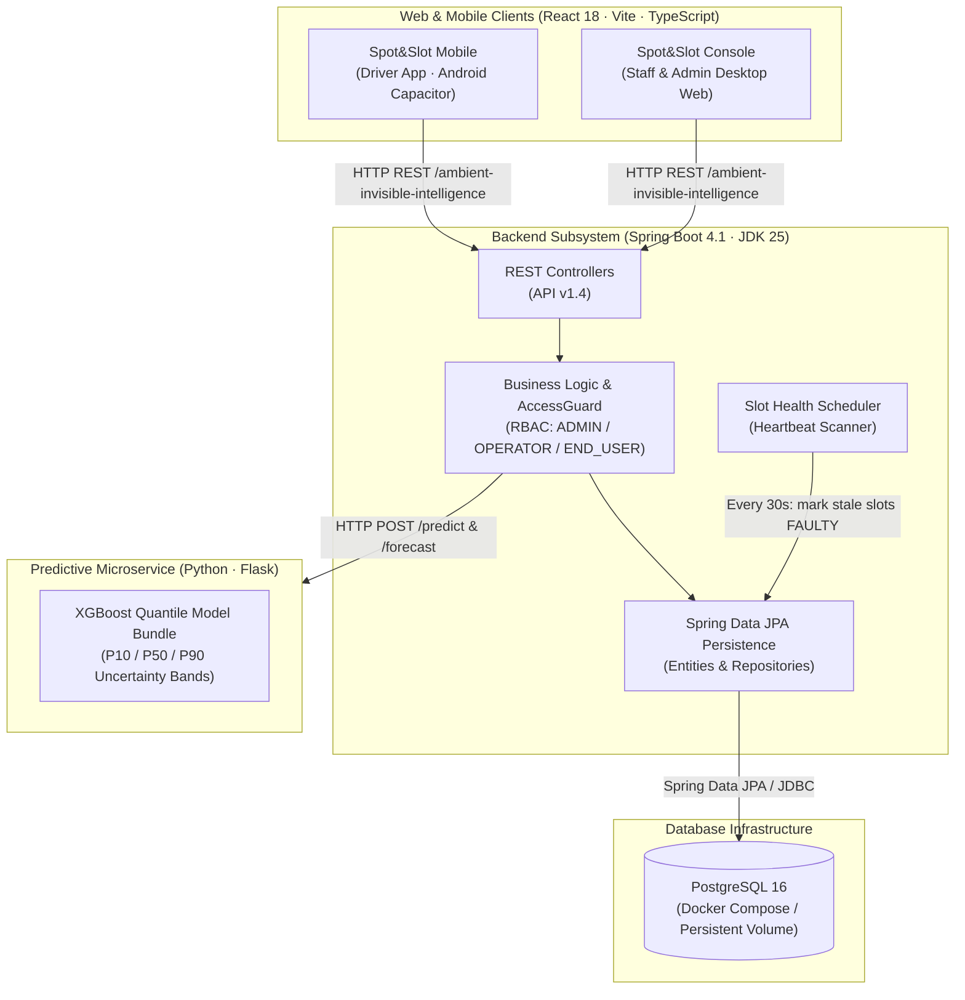

# Spot&Slot — Smart Parking Management System
> *"The Moovit of Parking"*

[](https://spring.io/projects/spring-boot)
[](https://www.oracle.com/java/)
[](https://www.postgresql.org/)
[](https://react.dev/)
[](https://www.typescriptlang.org/)
[](https://www.python.org/)
[](https://xgboost.readthedocs.io/)
[](https://www.docker.com/)
[-brightgreen?style=for-the-badge&logo=target)](https://github.com/AsayagOmer/SpotAndSlot)
[](./LICENSE)

---

## 📌 Project Overview

> 🏆 **Achievement**: Graded **100/100** — Ranked the **#1 Project** in the *Ambient Invisible Intelligence* course at Afeka College of Engineering (Spring 2026).

**Spot&Slot** is an end-to-end Smart Parking Management System designed around Gartner's **Ambient Invisible Intelligence (AII)** model. The system embeds real-time awareness and predictive machine learning seamlessly into urban parking infrastructure: drivers simply open the app to view live availability and accurate occupancy forecasts, without needing to know the complex sensing and modeling happening behind the scenes.

Developed at **Afeka College of Engineering** (Department of Software Engineering, Ambient Invisible Intelligence — Spring 2026), the platform addresses chronic urban parking congestion in dense metropolitan areas like North Tel Aviv by providing:
- Real-time availability tracking across parking lots, sections, and individual slots.
- Machine Learning future-occupancy predictions with confidence intervals.
- Role-based management for drivers, lot operators, and system administrators.
- Automated slot health and heartbeat monitoring.

---

## 🏗️ Architecture & Subsystems



The system is organized as a unified monorepo containing three core micro-components:

| Subsystem | Directory | Tech Stack | Description |
|---|---|---|---|
| **Backend API** | [`/backend`](./backend) | Spring Boot 4.1, JDK 25, Spring Data JPA, PostgreSQL | Central RESTful API (v1.4) managing entities, RBAC access guards, geo-spatial lookups, commands, and health schedulers. Verified with 111 passing automated tests (JUnit, Testcontainers, Cucumber BDD). |
| **Client Apps** | [`/client`](./client) | React 18, Vite 5, TypeScript, Tailwind CSS, shadcn/ui, TanStack Query, Capacitor | Cross-platform web and mobile clients: Driver Mobile App (Android APK via Capacitor & mobile web with Hebrew RTL support) + Operator/Admin Desktop Console. |
| **Predictive Service** | [`/predictive-service`](./predictive-service) | Python 3.10+, Flask, XGBoost, Scikit-learn, Pandas | ML microservice providing `/predict` and `/forecast` endpoints using an XGBoost quantile regression bundle (P10/P50/P90 confidence band) trained on calendar, seasonal, and holiday features ($R^2 = 0.948$). |
| **Documentation** | [`/docs`](./docs) | PDF | Complete architectural report, SRS v1.4, UX/UI research, model evaluation, and Kanban progression report. |

---

## 🏛️ Architectural Principles & Patterns

The architecture of **Spot&Slot** is grounded in established software engineering and distributed system principles:

1. **Ambient Invisible Intelligence (AII) (Gartner Model)**:
   Intelligence is seamlessly embedded into everyday infrastructure. Drivers receive accurate live availability and forecasts with minimal interaction, while complex sensing, telemetry ingestion, and ML inference run invisibly in the background.

2. **Boundary-Control-Entity (BCE) & Layered Separation**:
   Strict separation between external contracts and database schemas:
   - **Boundaries (DTOs)**: `UserBoundary`, `ObjectBoundary`, and `CommandBoundary` define the versioned REST contract (API v1.4).
   - **AccessGuard & RBAC**: Centralized security layer verifying caller credentials and role permissions (`ADMIN`, `OPERATOR`, `END_USER`) before any request hits domain logic.
   - **Control (Business Logic)**: Modular services (`ObjectsService`, `CommandsService`, `UsersService`) encapsulate business invariants, section availability grouping, and cascading lifecycle operations.
   - **Entities & Persistence**: Spring Data JPA repositories persist state to PostgreSQL via clean relational abstractions.

3. **Generic Metamodel & Command Pattern**:
   Instead of static tables for every domain object, physical entities (`PARKING_LOT`, `PARKING_SECTION`, `PARKING_SLOT`, `VEHICLE`) share an extensible metamodel with typed JSON attribute maps and hierarchical parent/child links. Domain operations are modeled as first-class executable commands dispatched, validated, and logged through `CommandBoundary`.

4. **Decoupled Polyglot Microservices**:
   Core transactional business logic (Java 25 / Spring Boot 4.1) is decoupled from statistical machine learning modeling (Python / Flask + XGBoost) and front-end clients (React 18 / Vite / Capacitor), communicating via versioned HTTP REST contracts for independent maintainability and scalability.

5. **Fail-Soft Graceful Degradation (Resilience)**:
   In the event the machine-learning microservice is unreachable, the API gracefully falls back to real-time heuristic slot availability calculations with an informational note, ensuring uninterrupted driver operations (NFR-2).

6. **Time-Triggered Autonomous Scheduling (Heartbeat Pattern)**:
   An autonomous scheduled background worker (`SlotHealthScheduler`) runs every 30 seconds (`<<Time>>` actor) to inspect slot heartbeats, automatically transitioning stale or disconnected sensors to `FAULTY` status without manual intervention.

---

## ✨ Key Capabilities

1. **Driver Experience (END_USER)**
   - Live lot map with visual vacant/occupied status (updated via ~5s polling).
   - "Moovit of Parking": Find the best section in a parking lot (`bestSectionInLot`).
   - Filter slots by attributes (e.g. `HANDICAP` accessible spaces).
   - Machine-learning powered 24-hour occupancy forecast with uncertainty bands (P10/P50/P90).
   - Geographic proximity search within a defined radius/square boundary (`byLocation`).

2. **Operator Oversight (OPERATOR)**
   - CRUD management of owned parking infrastructure: Lots, Sections, and Slots.
   - Fine-grained object hierarchy binding (parent/child relationships).
   - Manual slot state toggling (`FREE` / `OCCUPIED`).

3. **System Administration (ADMIN)**
   - User account auditing and elevated role provisioning (`OPERATOR`, `ADMIN`).
   - Comprehensive command invocation history log and system data purging.

4. **Background Health Monitoring**
   - Scheduled heartbeat scanner (`SlotHealthScheduler`) running every 30 seconds to flag stale or offline slots as `FAULTY`.

5. **Resilience & Graceful Degradation**
   - Fail-soft prediction fallback: if the Python ML microservice is unreachable, the API gracefully falls back to real-time heuristic counts with informational flags.

---

## 🚀 Getting Started

### Option 1: Run with Docker Compose (Recommended)

Start all services (PostgreSQL, Predictive ML Service, and Spring Boot Backend) with a single command:

```bash
docker compose up --build
```

- **Backend API**: `http://localhost:8084/ambient-invisible-intelligence`
- **Swagger / OpenAPI Documentation**: `http://localhost:8084/swagger-ui.html`
- **ML Microservice**: `http://localhost:5000`

### Option 2: Running Components Individually

#### 1. Start the Database
```bash
cd backend
docker compose up -d postgres
```

#### 2. Start the Predictive ML Service
```bash
cd predictive-service
python -m venv .venv
source .venv/bin/activate  # On Windows: .venv\Scripts\activate
pip install -r requirements.txt
python app.py
```

#### 3. Run the Spring Boot API
```bash
cd backend
# Windows:
gradlew.bat bootRun
# Linux / macOS:
./gradlew bootRun
```

#### 4. Run the Client Applications
```bash
cd client
npm install

# Driver Mobile App (runs on :8080):
npm run dev:mobile

# Staff / Admin Console (runs on :8090):
npm run dev:admin
```

---

## 🧪 Testing & Quality Assurance

- **Integration & BDD Suite**: 111 automated tests covering end-to-end REST interactions, role permission matrices, and edge cases using Testcontainers and Cucumber Gherkin feature files.
  ```bash
  cd backend
  ./gradlew test
  ```
- **Load & Performance Testing**: Apache JMeter 5.6.3 test plan (`backend/perf/smart-parking-perf.jmx`) under 10 concurrent users / 1,000 requests achieved 0.00% error rate and single-digit to ~18 ms average latency on paged reads and geographic searches.

---

## 👥 The Penguins Team & Project Roles

**Afeka College of Engineering** — Ambient Invisible Intelligence (Spring 2026)

### Core Team Roster
- **Omer Asayag** — Team Lead & Scrum Master
- **Avishay Haimov** — Product Owner
- **Tom Gurevich** — QA Engineer & Configuration Manager
- **Stephanie Kovaks** — Technical Writer & UI/UX Engineer
- **Shawn Farberov** — System Architect
- **Nicole Barghout** — DBA & DevOps

### 🌟 Key Individual Contributions — Omer Asayag
Beyond serving as **Team Lead & Scrum Master**, Omer played an active hands-on technical role across every stage of the system lifecycle:
- **Project Orchestration & Code Quality**: Orchestrated the overall cross-repository architecture, defined cross-service API contracts, coordinated agile sprints across sub-teams, and conducted thorough code reviews across all backend, client, and ML modules.
- **Machine Learning & Algorithmic Research**: Led the research, prototyping, and production deployment of the parking availability predictor. Evaluated multiple candidate algorithms (Linear Regression, Decision Trees, Random Forests, Gradient Boosting vs. XGBoost), trained and tuned the final **XGBoost quantile bundle (P10/P50/P90)** ($R^2 = 0.948$), and designed the capacity-independent scaling mechanism that enables a single model to serve arbitrary parking lots.
- **Data Engineering**: Collaborated closely with **Tom Gurevich** on synthetic data modeling and feature engineering pipelines (`mockdatagen.py`), synthesizing 43,800+ hourly data points across North Tel Aviv lots while integrating Israeli public holidays, Shabbat transitions, academic terms, and major regional events.
- **UI/UX Research, Product Strategy & Alpha Testing**: Actively partnered with **Avishay Haimov** and **Stephanie Kovaks** in conducting extensive user research and field interviews across North Tel Aviv, formulating user personas (Noa, Rami, Tomer). Together with **Avishay Haimov**, conducted hands-on alpha testing with local drivers and residents, translating user friction into critical design improvements (Hebrew RTL adaptation, transitioning alarming reds to calm visual palettes, and adding uncertainty-band forecast visualizations).

---

## 📄 License & Academic Integrity

> [!NOTE]
> **Repository & Institutional Policy Notice**: In accordance with Afeka College of Engineering's institutional policy, the original internal Bitbucket repositories and classroom version control servers cannot be shared publicly. This repository serves as the official, unified open-source release of the complete project files, documentation, and research artifacts.

This project is licensed under the MIT License — see the [LICENSE](./LICENSE) file for details.
